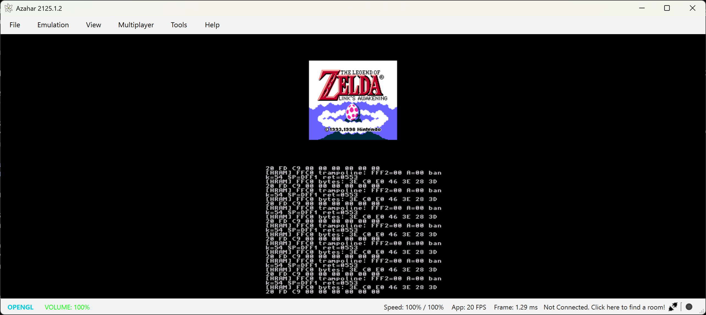
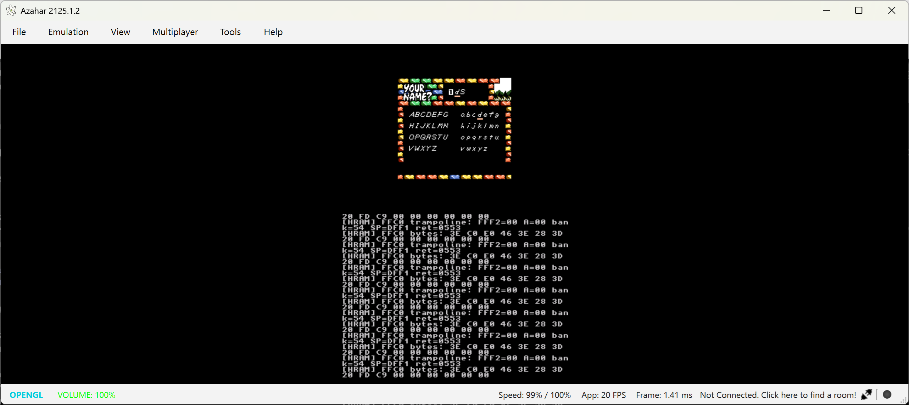
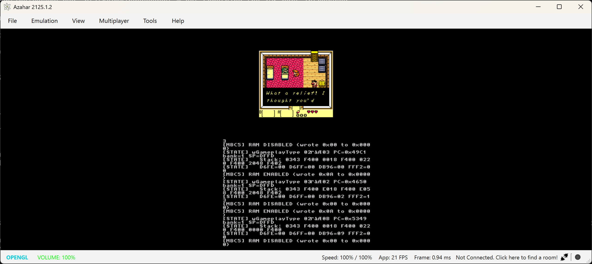
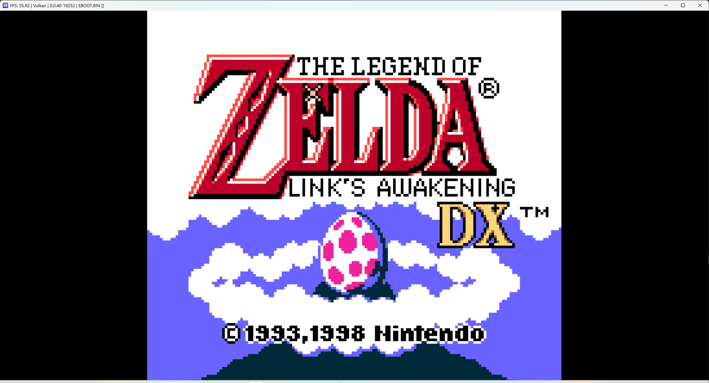
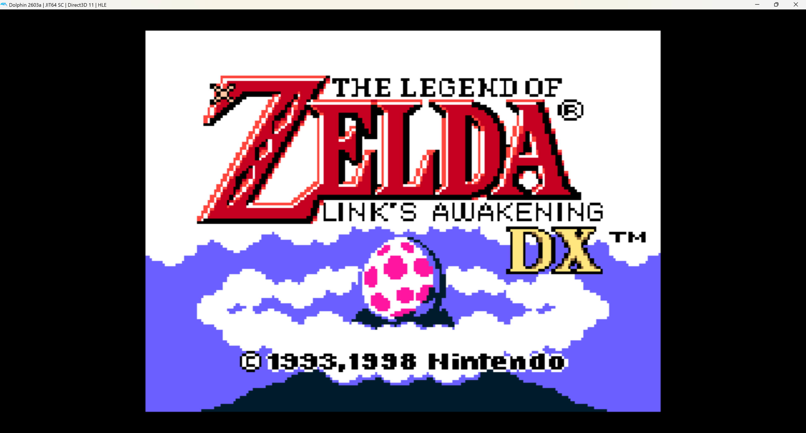
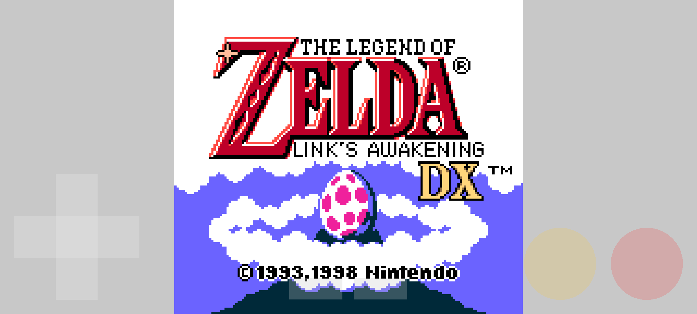
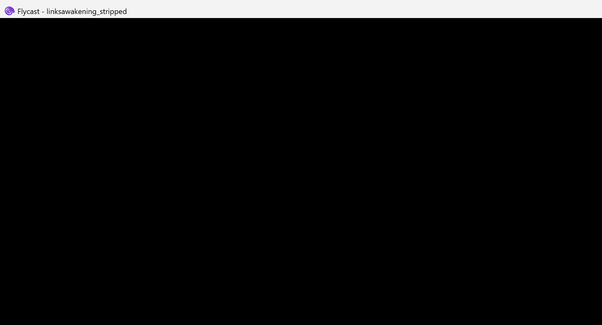

# linksawakening-portable

*The Legend of Zelda: Link's Awakening DX*, statically recompiled to C and
built for game consoles, handhelds, Android and the browser. It's the console
side of [LinksAwakening](https://github.com/sp00nznet/LinksAwakening): the same
game code and runtime, with one platform backend per target. You supply your
own ROM; no game code is distributed here.

Part of the sp00nznet recomp projects, built on the
[gb-recompiled](https://github.com/sp00nznet/gb-recompiled) toolkit and following
the same house style (generated code is never committed).

## Status

**v0.1.0.** Every target below builds from your ROM with one command (the
installer, `Setup.cmd` or `setup.sh`), tested end to end on 2026-10-20. "Last seen
running" is the most recent time someone actually ran that build; a target
that has only been built says so.

| Target | Backend | Builds (2026-10-20) | Last seen running |
|---|---|---|---|
| Windows | SDL2 ([LinksAwakening](https://github.com/sp00nznet/LinksAwakening)) | ✅ 23 MB exe | Plays through dungeons; headless run checked 2026-10-20 |
| PlayStation 4 | SDL2 (OpenOrbis) | ✅ 19 MB `.pkg` | Real hardware |
| PlayStation 3 | `platform_psl1ght.c` | ✅ 23 MB `EBOOT.BIN` | RPCS3, ~56 fps, title + gameplay |
| Nintendo 3DS | `platform_3ds.c` | ✅ 20 MB `.3dsx` | Azahar and a real New 2DS XL, gameplay |
| Nintendo Wii | `platform_wii.c` | ✅ 22 MB `.dol` | Dolphin, title + intro |
| Nintendo GameCube | `platform_gamecube.c` | ✅ 22 MB `.dol` | Not run yet |
| Sega Dreamcast | `platform_dreamcast.c` | ✅ 14 MB `.elf` (`-Os`) | Flycast, title screen; not full speed |
| PlayStation 2 | `platform_ps2.c` | ✅ 22 MB `.elf` | Not run yet |
| PSP | `platform_psp.c` | ✅ 20 MB `EBOOT.PBP` | Not run yet |
| PS Vita | `platform_vita.c` | ✅ 9.4 MB `.vpk` | Not run yet |
| Android | SDL2 (NDK) | ✅ 10 MB `.apk` (x86_64) | Android emulator, title screen |
| WebAssembly | SDL2 (Emscripten) | ✅ 14 MB `.wasm` | Browser: loads, renders, plays audio |
| Xbox 360 | `platform_libxenon.c` | ✅ 22 MB `.elf32` (XeLL) | Never: Xenia can't run libxenon homebrew; needs RGH/JTAG hardware |
| Original Xbox | SDL2 (NXDK) | ✅ 13 MB `.xbe` | Hangs at the Xbox logo in xemu |

Tested ROM: *Legend of Zelda, The - Link's Awakening DX (USA, Europe) (Rev 2)*,
SHA-1 `1c091225688d966928cc74336dbef2e07d12a47c`.

Multiplayer isn't part of these builds; it lives in
[la-mp](https://github.com/sp00nznet/la-mp).

## Screenshots

| 3DS — title (Azahar) | 3DS — name entry | 3DS — gameplay |
|----------------------|------------------|----------------|
|  |  |  |

| PS3 — title (RPCS3) | Wii — title (Dolphin) | Android — title (emulator) |
|---------------------|-----------------------|----------------------------|
|  |  |  |

| Sega Dreamcast — title (Flycast, stock 16 MB) |
|-----------------------------------------------|
|  |

## Getting Started

Every route builds all 13 consoles from your ROM inside Docker, so the only
thing to install is Docker itself:
[Docker Desktop](https://www.docker.com/products/docker-desktop/) on Windows
and macOS, or [Docker Engine](https://docs.docker.com/engine/install/) on
Linux. Start it before you begin. The first run downloads about 20 GB of
toolchain images and takes 1 to 2 hours. A rerun skips everything already
built.

### Installer (easiest)

1. Download the installer for your system from the
   [latest release](https://github.com/sp00nznet/linksawakening-portable/releases/latest):
   `LinksAwakening-Consoles-Installer-windows-x64.exe`, `-linux-x64.tar.gz` or
   `-macos-arm64.zip`. It isn't signed: on Windows, SmartScreen asks first
   (**More info**, **Run anyway**); on a Mac, open it once, then **Open Anyway**
   in System Settings → Privacy & Security.
2. Choose the folder your ROM is in (the `.gbc`, or a `.zip` with it inside),
   and press **Build**.
3. When it's done, **Console builds** opens the folder with one subfolder per
   console. `builds/README.txt` says which built and what's known to work.

The installer is [recomp-launcher](https://github.com/sp00nznet/recomp-launcher)
with [launcher/launcher.json](launcher/launcher.json); all it does is run the
setup script below with your ROM folder.

### Setup script

1. Get the source, with submodules:
   ```
   git clone --recurse-submodules https://github.com/sp00nznet/linksawakening-portable.git
   cd linksawakening-portable
   ```
   Trip-up: on Windows, `Filename too long` means the nested submodules hit
   the 260-character path limit. Run `git config --global core.longpaths true`
   (or clone to a shorter path), then `git submodule update --init --recursive`.
2. Run the setup, giving it your ROM's folder:
   - Windows: double-click `Setup.cmd` (it asks), or
     `tools\setup.ps1 -Game <folder>`
   - Linux and macOS: `./setup.sh --game-dir <folder>`

   Add `-Targets wii,psp` (`--targets wii,psp`) to build only some consoles.
3. The builds are in `builds/<console>/`, with a summary in
   `builds/README.txt`. Each console's full log is in `build-logs/`.

What it runs, step by step: [docs/BUILDING.md](docs/BUILDING.md). It turns
your ROM into C once in the `devkitpro/devkitppc` image
(`scripts/recomp.sh`), then runs each line of
[scripts/targets.tsv](scripts/targets.tsv) in that console's toolchain image.
You can run any one of those lines by hand.

## Usage

Each build is a normal homebrew package for its platform: copy it over and
launch it the way that platform runs homebrew (BUILDING.md has the details per
target). Saves go to a `linksawakening` folder on the target's storage
(`sd:/linksawakening/` on Wii and GameCube, `ms0:/linksawakening/` on PSP, and
so on), so they're kept when you rebuild.

## Building from source

- **Setup:** `setup.sh` (Linux, macOS) and `tools/setup.ps1` (Windows) do
  the same thing: check Docker, run `scripts/recomp.sh` (ROM to C), then every
  line of `scripts/targets.tsv`. Android's toolchain image is built from
  `docker/android.Dockerfile`.
- **Build scripts:** `scripts/build_<target>.sh`. They find the repo through
  `scripts/env.sh`, so they run from any checkout, under WSL or inside Docker
  with the repo mounted at `/src`, and skip recompiling `rom.c` when its
  object file is newer.
- **The game and runtime:** the `LinksAwakening/` submodule. It holds
  `rom_main.c` (one entry point for every target) and, inside it,
  `gbrecomp/runtime/` with every `platform_*.c` backend.
- **Porting notes:** [docs/PORTING.md](docs/PORTING.md) (the platform contract),
  [docs/ENDIAN_AUDIT.md](docs/ENDIAN_AUDIT.md) (big-endian targets),
  [docs/PAL_AUDIT.md](docs/PAL_AUDIT.md).

```
.
├── LinksAwakening/   submodule: entry point, gen/ (your ROM's code), gbrecomp/ (runtime)
├── scripts/          build_<target>.sh, env.sh, PS4 packaging, WASM shell
├── android/          Gradle project (SDL2 is staged in at build time)
├── xbox/             NXDK Makefile
├── docs/             BUILDING.md and the porting notes
└── screenshots/
```

## Credits

- Recompiler and runtime: [arcanite24/gb-recompiled](https://github.com/arcanite24/gb-recompiled),
  with our changes in [sp00nznet/gb-recompiled](https://github.com/sp00nznet/gb-recompiled)
- Game knowledge: the [LADX-Disassembly](https://github.com/zladx/LADX-Disassembly) contributors
- Toolchains: [devkitPro](https://devkitpro.org/) (Wii, GameCube, 3DS),
  [PSL1GHT](https://github.com/ps3dev/PSL1GHT) (PS3),
  [OpenOrbis](https://github.com/OpenOrbis/OpenOrbis-PS4-Toolchain) (PS4),
  [KallistiOS](https://github.com/KallistiOS/KallistiOS) (Dreamcast),
  [PS2SDK](https://github.com/ps2dev/ps2sdk) and [gsKit](https://github.com/ps2dev/gsKit) (PS2),
  [pspdev](https://github.com/pspdev/pspdev) (PSP), [VitaSDK](https://vitasdk.org/) (Vita),
  [libxenon](https://github.com/Free60Project/libxenon) (Xbox 360),
  [nxdk](https://github.com/XboxDev/nxdk) (original Xbox),
  [Emscripten](https://emscripten.org/), the Android NDK, and [SDL2](https://github.com/libsdl-org/SDL)

## License

The code in this repository is [MIT](LICENSE).

That covers the build scripts, packaging and documentation. It does not and
cannot cover *The Legend of Zelda: Link's Awakening DX*: the game's code, art,
audio and data belong to Nintendo, are not distributed here, and you need your
own legitimate copy. The C generated from your ROM is a derivative of the game
and is never committed. This project is not affiliated with or endorsed by
Nintendo.
